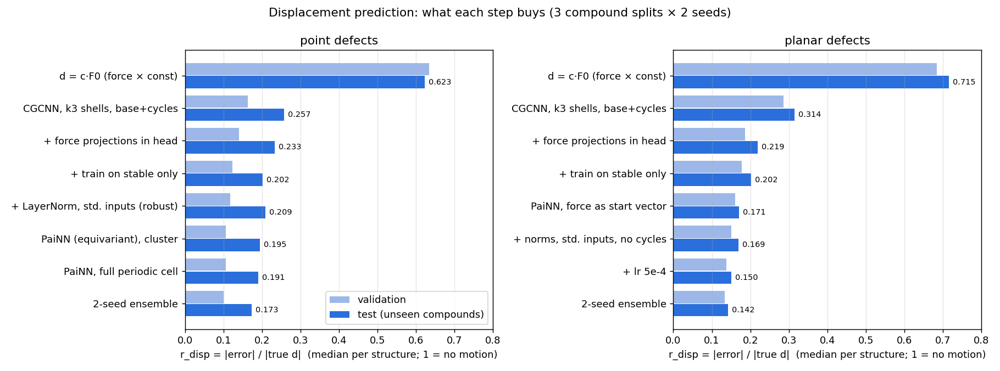

# Predicting atomic relaxation displacements (point and planar defects)

Goal: predict, per atom, the displacement vector from the unrelaxed to the relaxed (GRACE-2L-UEA-OMAT-large)
structure, with separate models for point defects (C15 supercells, 651 structures / 217 compounds) and planar
faults (Laves stacking sequences, 1978 structures). Relaxed position = initial position + predicted vector.

## Bottom line

| | final model | r_disp val / test | test, 2-seed ensemble | pooled skill (test) |
|---|---|---|---|---|
| point | PaiNN on the **full periodic cell**, k3 edges, base + initial-force features, trained on stable structures, LayerNorm/vector-norm + standardised inputs | 0.106 / 0.191 | **0.100 / 0.173** | 0.78 |
| planar | PaiNN, k3 edges, base + force features, initial force as start vector (eqvF), stable-only, norms + standardised inputs, lr 5e-4 | 0.138 / 0.150 | **0.133 / 0.142** | 0.32 |
| reference | d = c · F0 (initial force × one fitted constant) | | point 0.62, planar 0.72 | 0.48 / 0.26 |

r_disp = per structure |error|₂ / |true displacement|₂ over the scored atoms, median over moving, stable
structures (1 = as good as predicting no motion). Numbers are means over **3 compound splits × 2 seeds**;
"test" = compounds never seen in training. Point models are scored on all atoms within 8.9 Å of the defect.

The direction of the motion is essentially solved (median cosine 0.995 point / 1.000 planar); the remaining
error is in the magnitude and concentrated in a few compounds.

Plots: `progression.png` (what each step buys), `final_models.png` (parity, magnitude, error vs distance,
per-structure error), `runs/phase1_overview.png` (phase-1 screen).




## What the graph needs (answers to "how should we build the graphs")

1. **Initial forces are the key extra information.** In planar faults, |F|, plus the bond projections F·u on
   the edges, plus the force fed into the equivariant head (or used as the PaiNN start vector), takes r_disp
   from 0.29 to 0.18. For point defects the effect is smaller (0.16 to 0.14) but consistent. The forces come
   free with the unrelaxed single point.
2. **Edges: the first 3 neighbour shells (k3) are best.** k1 and k2 lack context; k5/k8 are worse (more
   noise, and with the 6 Å cutoff they turn into "everything within 6 Å"). Radius-based edges are not needed:
   shell-based edges adapt to the lattice parameter.
3. **Cycle counts don't help.** They are constant per sublattice in the point cells and redundant with the
   type information; for planar, base + force without cycles is as good or better.
4. **Direction-to-defect features don't help** (with and without force).
5. **Equivariant output is necessary.** A non-equivariant "direct" head is worse (negative pooled skill). The
   edge head `d_i = Σ_j φ(h_i, h_j, r_ij, F·u) u_ij` works with the production CGCNN; a fully equivariant
   backbone (PaiNN, vector features) is better again, especially for planar.
6. **Point cells: full periodic cell vs cut-out cluster is a wash** once the models are normalised (0.106 vs
   0.106 val). The full cell removes the artificial cluster boundary (null defects stay ≤ 0.03 Å), so it is the
   cleaner choice; the cluster (8.9 Å target + 4 Å buffer) is 3–4× cheaper. A smaller loss region (6.4 Å) is
   clearly worse.
7. **Train on stable structures only** (about 10 % of the structures relax far from the defect or change their
   stacking); this helps both domains.

## Robustness: blow-ups and the fix

The production CGCNN sums about 30 neighbour messages per layer with no normalisation. Both it and a plain
PaiNN produced predictions of 10–10¹³ Å on a few out-of-distribution test compounds, even on null defects.
- Point offenders: Ag-Be, Sn-Mg, Bi-Au, and above all Np-Mn (initial forces up to 5.9 eV/Å, against ≤ 2 elsewhere).
- Planar offenders: Cs-Bi, Pu-Zn.

The median metric hid this, but the pooled skill went to −10⁵.

Fix (now used everywhere):
- `--norm`: LayerNorm after each CGCNN layer and on h before the head. For PaiNN: LayerNorm on the scalars
  and an equivariant RMS norm on the vectors after every layer.
- `--std-inputs`: node and edge features z-scored with training-set statistics.

After the fix, the test skill is 0.3–0.9 for every run, and null defects stay ≤ 0.03 Å (median).

## Optimisation / capacity

- Deeper networks are worse (6 layers: 0.32–0.46; PaiNN 3 or 5 layers ≈ 4 layers).
- Width 256 gives no gain on test.
- MSE beats Huber/L1.
- Planar benefits from a lower learning rate (5e-4: 0.150 → 0.138 val).
- A 2-seed ensemble gains another 3–10 %.
- The Transformer backbone stays clearly behind CGCNN/PaiNN in every setting.

## Where it still fails

- **Point:** split 1 is consistently harder (test 0.23–0.33), because its test set contains the extreme
  compounds (Np-Mn). Errors decay with distance, as the true motion does (`final_models.png`, top right).
- **Planar:** 47 of 832 stable test structures have r > 0.8, and they are **whole compounds**, across all
  their stacking sequences: Cs-Bi, Pr-Ru, Zr-Ir, Ce-Os, La-Os. For Zr-Ir, all atoms move about 0.3 Å in every
  sequence, which looks like the bulk reference structure itself relaxing rather than a fault effect. This is a
  chemistry-generalisation limit (unseen compounds), not a graph-construction one. It is the reason the pooled
  planar R² is low (0.27) although the median is good.

## Phases run (all on W&B, project yara-crystals, groups disp-phase1 … disp-phase5)

| phase | runs | content | table |
|---|---|---|---|
| 1 | 192 | one-factor screen: features, edges, heads, losses, regions × CGCNN/Transformer, 1 split | `runs/analysis_phase1.md` |
| 1b | 36 | full periodic point cells, PaiNN backbone | `runs/analysis_phase1.md` |
| 2 / 2b | 210 | sharpening around CGCNN + force head, 3 splits × 2 seeds; LayerNorm / std-input fix | `runs_p2/analysis_phase2.md` |
| 3 | 66 | PaiNN, 3 splits × 2 seeds | `runs_p3/analysis_phase3.md` |
| 4 | 54 | normalised PaiNN, force capping, normalised full-cell CGCNN | `runs_p4/analysis_phase4.md` |
| 5 | 48 | PaiNN width / depth / learning rate | `runs_p5/analysis_phase5.md` |

## Code

| file | role |
|---|---|
| `build_superset.py` | raw dumps → superset graphs: all shells to 6 Å, forces, cycles, defect labels. Builds `data/superset_{point,point_full,planar}.pt` |
| `views.py` | cheap dataset variants: region, edge rule, feature groups, stable-only, force cap |
| `models.py` | CGCNN/Transformer backbone + equivariant heads; PaiNN; `norm` option |
| `train_disp.py` | training, metrics, W&B, results JSON + saved predictions |
| `make_tasks.py` | task files per phase |
| `analyze.py` | tables per phase |
| `ensemble.py` | seed-ensemble metrics |
| `plot_*.py` | plots |

To reproduce a final model:
```
python displacement/train_disp.py --domain point_full --model painn --view "rt=8.9,edge=k3,feat=base+force,stable=1" --head eqv --norm --std-inputs --split-seed 0 --seed 0 --save-preds
python displacement/train_disp.py --domain planar --model painn --view "edge=k3,feat=base+force,stable=1" --head eqvF --norm --std-inputs --lr 5e-4 --split-seed 0 --seed 0 --save-preds
```

## Suggested next steps

- **Combined point + planar model** (the teaser): same PaiNN, `domain` as an input flag, both datasets. The
  planar model's cell head must be optional per graph.
- **Production model:** train on all compounds (no test hold-out) with a 3–5 seed ensemble.
- **Check the failing planar compounds** (Zr-Ir, Pr-Ru, Cs-Bi): is the bulk reference already off-equilibrium
  for this potential? If yes, flag them like the unstable structures.
- **Possibly an iterative scheme:** predict, recompute forces with GRACE, predict again. This uses the finding
  that the forces carry most of the information.
