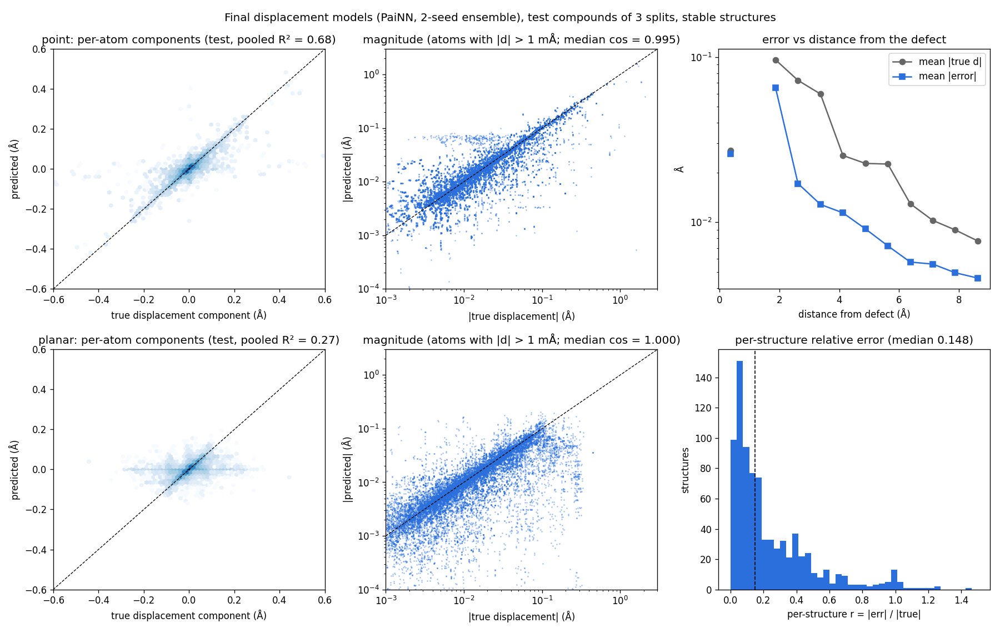

# Predicting atomic relaxation displacements (point and planar defects)

Goal: predict, per atom, the displacement vector from the unrelaxed to the relaxed (GRACE-2L-UEA-OMAT-large)
structure, with separate models for point defects (C15 supercells, 651 structures / 217 compounds) and planar
faults (Laves stacking sequences, 1978 structures). Relaxed position = initial position + predicted vector.

## Bottom line

| | final model | r_disp val / test | test, 2-seed ensemble | pooled skill (test) |
|---|---|---|---|---|
| point | PaiNN on the **full periodic cell**, k3 edges, base + initial-force features, trained on stable structures, LayerNorm/vector-norm + standardised inputs | 0.106 / 0.191 | **0.100 / 0.173** | 0.78 |
| planar | PaiNN, k3 edges, base + force features, initial force as start vector (eqvF), stable-only, norms + standardised inputs, lr 5e-4 | 0.138 / 0.150 | **0.133 / 0.142** | 0.32 |
| reference | d = c · F0 (initial force × one fitted constant) | | point 0.62, planar 0.72 | 0.48 / 0.26 |

r_disp = per structure |error|₂ / |true displacement|₂ over the scored atoms, median over moving, stable
structures (1 = as good as predicting no motion). Numbers are means over **3 compound splits × 2 seeds**;
"test" = compounds never seen in training. Point models are scored on all atoms within 8.9 Å of the defect.

The direction of the motion is essentially solved (median cosine 0.995 point / 1.000 planar); the remaining
error is in the magnitude and concentrated in a few compounds.

Plots: `progression.png` (what each step buys), `final_models.png` (parity, magnitude, error vs distance,
per-structure error), `runs/phase1_overview.png` (phase-1 screen).




## What the graph needs (answers to "how should we build the graphs")

1. **Initial forces are the key extra information.** In planar faults, |F|, plus the bond projections F·u on
   the edges, plus the force fed into the equivariant head (or used as the PaiNN start vector), takes r_disp
   from 0.29 to 0.18. For point defects the effect is smaller (0.16 to 0.14) but consistent. The forces come
   free with the unrelaxed single point.
2. **Edges: the first 3 neighbour shells (k3) are best.** k1 and k2 lack context; k5/k8 are worse (more
   noise, and with the 6 Å cutoff they turn into "everything within 6 Å"). Radius-based edges are not needed:
   shell-based edges adapt to the lattice parameter.
3. **Cycle counts don't help.** They are constant per sublattice in the point cells and redundant with the
   type information; for planar, base + force without cycles is as good or better.
4. **Direction-to-defect features don't help** (with and without force).
5. **Equivariant output is necessary.** A non-equivariant "direct" head is worse (negative pooled skill). The
   edge head `d_i = Σ_j φ(h_i, h_j, r_ij, F·u) u_ij` works with the production CGCNN; a fully equivariant
   backbone (PaiNN, vector features) is better again, especially for planar.
6. **Point cells: full periodic cell vs cut-out cluster is a wash** once the models are normalised (0.106 vs
   0.106 val). The full cell removes the artificial cluster boundary (null defects stay ≤ 0.03 Å), so it is the
   cleaner choice; the cluster (8.9 Å target + 4 Å buffer) is 3–4× cheaper. A smaller loss region (6.4 Å) is
   clearly worse.
7. **Train on stable structures only** (about 10 % of the structures relax far from the defect or change their
   stacking); this helps both domains.

## Robustness: blow-ups and the fix

The production CGCNN sums about 30 neighbour messages per layer with no normalisation. Both it and a plain
PaiNN produced predictions of 10–10¹³ Å on a few out-of-distribution test compounds, even on null defects.
- Point offenders: Ag-Be, Sn-Mg, Bi-Au, and above all Np-Mn (initial forces up to 5.9 eV/Å, against ≤ 2 elsewhere).
- Planar offenders: Cs-Bi, Pu-Zn.

The median metric hid this, but the pooled skill went to −10⁵.

Fix (now used everywhere):
- `--norm`: LayerNorm after each CGCNN layer and on h before the head. For PaiNN: LayerNorm on the scalars
  and an equivariant RMS norm on the vectors after every layer.
- `--std-inputs`: node and edge features z-scored with training-set statistics.

After the fix, the test skill is 0.3–0.9 for every run, and null defects stay ≤ 0.03 Å (median).

## Optimisation / capacity

- Deeper networks are worse (6 layers: 0.32–0.46; PaiNN 3 or 5 layers ≈ 4 layers).
- Width 256 gives no gain on test.
- MSE beats Huber/L1.
- Planar benefits from a lower learning rate (5e-4: 0.150 → 0.138 val).
- A 2-seed ensemble gains another 3–10 %.
- The Transformer backbone stays clearly behind CGCNN/PaiNN in every setting.

## Where it still fails

- **Point:** split 1 is consistently harder (test 0.23–0.33), because its test set contains the extreme
  compounds (Np-Mn). Errors decay with distance, as the true motion does (`final_models.png`, top right).
- **Planar:** 47 of 832 stable test structures have r > 0.8, and they are **whole compounds**, across all
  their stacking sequences: Cs-Bi, Pr-Ru, Zr-Ir, Ce-Os, La-Os. For Zr-Ir, all atoms move about 0.3 Å in every
  sequence, which looks like the bulk reference structure itself relaxing rather than a fault effect. This is a
  chemistry-generalisation limit (unseen compounds), not a graph-construction one. It is the reason the pooled
  planar R² is low (0.27) although the median is good.

## Phases run (all on W&B, project yara-crystals, groups disp-phase1 … disp-phase5)

| phase | runs | content | table |
|---|---|---|---|
| 1 | 192 | one-factor screen: features, edges, heads, losses, regions × CGCNN/Transformer, 1 split | `runs/analysis_phase1.md` |
| 1b | 36 | full periodic point cells, PaiNN backbone | `runs/analysis_phase1.md` |
| 2 / 2b | 210 | sharpening around CGCNN + force head, 3 splits × 2 seeds; LayerNorm / std-input fix | `runs_p2/analysis_phase2.md` |
| 3 | 66 | PaiNN, 3 splits × 2 seeds | `runs_p3/analysis_phase3.md` |
| 4 | 54 | normalised PaiNN, force capping, normalised full-cell CGCNN | `runs_p4/analysis_phase4.md` |
| 5 | 48 | PaiNN width / depth / learning rate | `runs_p5/analysis_phase5.md` |

## Code

| file | role |
|---|---|
| `build_superset.py` | raw dumps → superset graphs: all shells to 6 Å, forces, cycles, defect labels. Builds `data/superset_{point,point_full,planar}.pt` |
| `views.py` | cheap dataset variants: region, edge rule, feature groups, stable-only, force cap |
| `models.py` | CGCNN/Transformer backbone + equivariant heads; PaiNN; `norm` option |
| `train_disp.py` | training, metrics, W&B, results JSON + saved predictions |
| `make_tasks.py` | task files per phase |
| `analyze.py` | tables per phase |
| `ensemble.py` | seed-ensemble metrics |
| `plot_*.py` | plots |

To reproduce a final model:
```
python displacement/train_disp.py --domain point_full --model painn --view "rt=8.9,edge=k3,feat=base+force,stable=1" --head eqv --norm --std-inputs --split-seed 0 --seed 0 --save-preds
python displacement/train_disp.py --domain planar --model painn --view "edge=k3,feat=base+force,stable=1" --head eqvF --norm --std-inputs --lr 5e-4 --split-seed 0 --seed 0 --save-preds
```

## Suggested next steps

- **Combined point + planar model** (the teaser): same PaiNN, `domain` as an input flag, both datasets. The
  planar model's cell head must be optional per graph.
- **Production model:** train on all compounds (no test hold-out) with a 3–5 seed ensemble.
- **Check the failing planar compounds** (Zr-Ir, Pr-Ru, Cs-Bi): is the bulk reference already off-equilibrium
  for this potential? If yes, flag them like the unstable structures.
- **Possibly an iterative scheme:** predict, recompute forces with GRACE, predict again. This uses the finding
  that the forces carry most of the information.

## Authors' models on our data (DefiNet, E3Relax, E3Relax-H2; runs_ext, runs_ext2)
r_disp val / test, 3 splits x 2 seeds. Vendored models in `ext/`, wrapper `ext/wrapper.py`.
- Point: DefiNet as published 0.184 / 0.295; DefiNet + our inputs 0.118 / 0.157; E3Relax(-H2) + ours about 0.15 / 0.23.
- Planar: DefiNet + ours 0.151 / 0.153 vs PaiNN 0.138 / 0.150.
- Ablation (W&B group disp-ext2, point; base DefiNet + ours):
  - static geometry 0.123 / 0.167
  - no virtual node 0.133 / 0.176
  - MSE loss 0.126 / 0.178
  - h128 0.149 / 0.196
  - no EMA 0.118 / 0.154
  - k3 graph **0.106 / 0.150**
- **PaiNN + DefiNet recipe** (L1, h512, lr 1e-4, EMA, amsgrad): **0.080 / 0.158**, vs PaiNN baseline 0.104 / 0.185.
- Planar with the k3 graph: 0.137 / 0.143.
- So the gain comes from the recipe and the virtual node, not from the iterative position updates.

## External benchmarks on the authors' datasets (runs_bench, W&B group disp-bench)
Data: DefiNet 2D defects (Zenodo 14027373) and the E3Relax-H2 sets (Zenodo 19212240), with the authors' splits.
- Pipeline: `bench/grace_feats.py` (GRACE venv: single point plus a GRACE relaxation of the test set), then `bench/build_views.py`, then `train_disp.py --domain bench:<ds>`.
- Aggregation: `bench/aggregate.py` writes `bench_data/bench_summary.json`. The GRACE baseline is in `bench_data/grace_baseline.json`. Plot: `plots/bench_mae_pos.png`.
- Checkpoints are selected by validation coordinate MAE (mae_pos).

Test coordinate MAE (Angstrom), mean of 3 seeds:

| dataset | unrelaxed | GRACE relax | authors' model | + GRACE in | PaiNN no-GRACE | PaiNN + GRACE | PaiNN + GRACE + recipe | E3Relax-H2 (paper) |
|---|---|---|---|---|---|---|---|---|
| DefiNet low | 0.0243 | 0.0071 | 0.0017 | 0.0017 | 0.0019 | 0.0019 | 0.0017 | – |
| DefiNet high | 0.0781 | 0.0507 | **0.0390** | 0.0394 | 0.0472 | 0.0436 | 0.0420 | – |
| MP | 0.0965 | 0.0844 | 0.0565 | 0.0553 | 0.0638 | 0.0547 | **0.0518** | 0.054 |
| JARVIS | 0.0550 | 0.0693 | 0.0407 | 0.0408 | 0.0448 | 0.0434 | **0.0405** | 0.040 |
| vdW | 0.1508 | 0.1814 | 0.1164 | **0.1123** | 0.1202 | 0.1140 | 0.1125 | 0.114 |
| XMnO | 0.3185 | 0.2240 | **0.1039** | 0.1048 | 0.1460 | 0.1443 | 0.1350 | 0.092 |
| C2DB | 0.2688 | 0.3293 | **0.1683** | 0.1675 | 0.2477 | 0.2555 | 0.2306 | 0.161 |

The authors' model is DefiNet for the DefiNet sets and E3Relax for the others.

Conclusions:
- **Pipeline is sound.** The unrelaxed rows match the papers' Dummy numbers, and our E3Relax reproduces the paper's E3Relax.
- **GRACE inputs help PaiNN on 6 of 7 sets** (MP -14%) but hardly help the iterative models.
- **PaiNN + GRACE + recipe is state of the art or tied** on MP, JARVIS and vdW.
- **PaiNN clearly loses on large relaxations.** On XMnO and C2DB, where cells change a lot, iterative position/cell updates matter, and PaiNN's C2DB cell head fails (shape 35 vs 6.4).

Caveats:
- GRACE-OMAT's training data overlaps with MP, so the MP result may be helped by leakage.
- The GRACE functional (PBE) differs from the reference on JARVIS (OptB88-vdW) and the vdW set.
- The published DefiNet high-density val.csv is identical to train.csv. We re-held out every 8th training structure for validation (350/50/50 per material).
- E3Relax + GRACE on XMnO diverged on one test cell (mp-625475_pox_h_sr). Excluding it gives shape 3.77 and volume 3.92.

## One model for point defects and planar faults (runs_joint, W&B group disp-joint)
`train_disp.py --domain joint` trains one model on both datasets:
- a point/planar one-hot in the node features (`--no-domflag` removes it);
- a separate target scale per domain;
- the loss is the mean of the point and planar losses (`--no-dom-balance` turns this off);
- the cell head is trained on planar faults only;
- the translation gauge (zero mean displacement per structure) is applied to planar faults only.

All runs, including the separate baselines (`--union-split`), use one compound split over the union of compounds, so a test compound is unseen in both domains.

Test r_disp, with pooled skill in brackets; 3 splits x 2 seeds:

| | point, separate | point, joint | planar, separate | planar, joint |
|---|---|---|---|---|
| PaiNN, DefiNet recipe | 0.134 (0.55) | 0.142 (0.64) | 0.150 (0.53) | 0.148 (0.52) |
| DefiNet + our inputs, k3 | 0.138 (0.57) | 0.150 (0.65) | 0.149 (0.54) | **0.139** (0.55) |
| ensemble PaiNN + DefiNet, 4 members | **0.122** (0.66) | 0.129 (**0.70**) | 0.134 (0.55) | **0.125** (0.56) |
| previous production PaiNN | 0.170 (0.29) | | 0.171 | |

Conclusions:
- Joint matches separate.
- Planar improves.
- Point: the median gets slightly worse, but pooled skill improves (fewer large misses).
- The domain flag and the loss balancing make no difference.
- Candidate for production: the joint PaiNN + DefiNet ensemble.

Plot: `plots/joint_vs_separate.png`.

## Production position model (runs_final -> production/, W&B group disp-final)
The joint PaiNN (DefiNet recipe) and the joint DefiNet (our inputs), 2 seeds each, trained on 90% of all compounds. The remaining 10% is used for checkpoint selection only, so these numbers are optimistic.
- The 4 checkpoints are in `production/`.
- Inference: `python displacement/predict_disp.py <superset.pt> <out.pt>`. It reproduces the saved predictions to within 1e-4 Å.

Held-out 10% (66 point, 190 planar structures), r_disp:

| members | point | planar |
|---|---|---|
| PaiNN x2 | 0.079 | 0.131 |
| DefiNet x2 | 0.078 | 0.115 |
| all 4 | **0.073** | **0.110** |

## Energy as a second output (runs_energy, W&B group disp-energy; `energy_study.py`)
`--energy-weight λ` adds a per-atom energy head to the joint PaiNN. Setup:
- Target: relaxation energy per atom, pe1 − pe0.
- Loss: per-atom L1 plus the relative error of the total, balanced over the two domains, on stable structures only.
- `--pos-weight 0` trains energy only.
- `--e-coupling` adds a learned a·F0·d_pred term to the head.

Reference without any energy training: the harmonic estimate ΔE ≈ −½ Σ F0·d.
- With the true d it has 5% error (point) and 2% error (planar).
- With predicted d it converts any position model into an energy model.

Test results, 3 splits x 2 seeds. Energy is the median relative error of the total, with MAE in brackets. Energy columns are seed-ensembled.

| model | r_disp point | r_disp planar | point: head | point: −½ΣF0·d | planar: head | planar: −½ΣF0·d |
|---|---|---|---|---|---|---|
| position only (runs_joint) | 0.142 | 0.148 | – | 0.087 (0.100 eV) | – | 0.062 (17 meV) |
| energy only | – | – | 0.084 (0.090 eV) | – | 0.111 (24 meV) | – |
| multi-task λ=0.3 | **0.133** | **0.142** | 0.066 (0.083 eV) | 0.088 | 0.114 (29 meV) | **0.054** (17 meV) |
| multi-task λ=1 | 0.148 | 0.146 | 0.076 (0.085 eV) | 0.092 | 0.111 | 0.054 |
| multi-task λ=3 | 0.162 | 0.154 | **0.060** (0.100 eV) | 0.097 | 0.112 | 0.053 |
| multi-task λ=1 + F0·d | 0.135 | 0.145 | 0.067 (**0.078 eV**) | 0.091 | 0.099 (28 meV) | 0.056 |

Conclusions:
- **Energy at λ=0.3 is a useful auxiliary task for positions.** Paired against position-only:
  - point −0.009 ± 0.002 (6/6 runs better);
  - planar −0.006 ± 0.002 (5/6 runs better).
  - Larger λ hurts positions (λ=3: point +0.020).
- **Point-defect energy: the learned head is better** than −½ΣF0·d_pred, about 7% vs 9% error. Multi-task beats energy-only.
- **Planar-fault energy: −½ΣF0·d_pred is clearly better** than any learned head, 5% vs 11% error. Planar ΔE is small (median 0.06 eV), and the head adds noise summed over many atoms.
- `predict_disp.py` now also returns:
  - `e_harm`;
  - `e_head` (members with an energy head);
  - `e_relax`, the recommended estimate: the head for point defects and the harmonic estimate for planar faults.
- Next: `runs_final_mt`, the multi-task λ=0.3 PaiNN trained on the production split (2 seeds; `make_tasks.py final_mt`). It is a candidate to replace the 2 position-only PaiNN members in `production/`.

Plot: `plots/energy_multitask.png`.

## Unified model: point, planar and mixed cells (job 5482173, `runs_unified`)

Goal: one model that handles a cell containing both a point defect and a planar fault, for positions and energy, with no domain switch.

**Mixed data** (`displacement/mixed/`, `data/superset_mixed.pt`):
- Planar-fault cells (same unrelaxed inputs as the planar data) repeated in-plane to ≥ 15 Å, 162–384 atoms; per cell four variants: pure fault / antisite in the fault layer / antisite farthest from it / random antisite.
- 1536 cells, 193 compounds; relaxed with GRACE in ASE (c vector free, FIRE + LBFGS, fmax 1e-3). Protocol check vs the LAMMPS planar labels on 24 cells: displacement rel. err 0.007, Δc 0.0007 Å, ΔE rel. err 0.001.
- All converged, 4% unstable; median ΔE −0.58 eV (pure fault), −1.36 to −1.46 eV (with antisite).
- Split by the same union compound split (~220 test cells per split).

**Unified model (`--unified`)**: no domain flag; one displacement scale and one energy unit (per-source weights only inside the loss); separate per-atom channels is_point_defect / dist_point / is_fault / dist_fault and a split defect-edge channel; full periodic cells use the translation gauge; cell head for all periodic cells. `--mixed train` adds the mixed training cells; `--mixed eval` only scores them. `--e-harm`: energy = head + (−½ΣF0·d_pred), i.e. the head learns the residual.

Test results, single models, mean ± std over 3 splits × 2 seeds (`python displacement/unified_study.py`):

| config | r pt | r pl | r mixed all | r mixed antisite region | r mixed pure fault | E pt | E pl | E mixed |
|---|---|---|---|---|---|---|---|---|
| PaiNN unified, pos-only, zero-shot | 0.137 | 0.147 | 0.392 | 0.437 | 0.173 | – | – | – |
| PaiNN unified λ=0.3, zero-shot | 0.139 | 0.144 | 0.392 | 0.442 | 0.172 | 0.079 | 0.133 | 0.231 |
| … + harmonic residual | 0.138 | 0.144 | 0.399 | 0.448 | 0.169 | 0.063 | 0.095 | 0.162 |
| … + harmonic residual, detached | 0.142 | 0.145 | 0.403 | 0.458 | 0.175 | 0.059 | 0.100 | 0.158 |
| DefiNet unified, zero-shot | 0.147 | 0.144 | 0.328 | 0.358 | 0.194 | – | – | – |
| **PaiNN unified λ=0.3, mixed-trained** | **0.131** | **0.138** | 0.220 | 0.237 | **0.125** | 0.072 | 0.115 | 0.091 |
| **… + harmonic residual** | 0.139 | 0.143 | **0.218** | **0.235** | 0.134 | **0.060** | **0.097** | **0.071** |
| DefiNet unified, mixed-trained | 0.132 | 0.140 | 0.229 | 0.248 | 0.133 | – | – | – |

Seed-ensembled on the mixed test cells (`mixed/eval_mixed.py`, `mixed_data/eval_unified.txt`), r_disp all / antisite region / pure fault, energy rel. err head (−½ΣF0·d):
- old joint PaiNN λ=0.3 with domain flag (mixed cell fed as planar, antisite merged into the defect channel): 0.426 / 0.497 / 0.158, 0.282 (0.161)
- PaiNN unified zero-shot: 0.373 / 0.433 / 0.165, 0.237 (0.109)
- DefiNet unified zero-shot: 0.304 / 0.350 / 0.181, – (0.072)
- PaiNN unified mixed-trained: 0.194 / 0.230 / 0.121, 0.088 (0.053)
- PaiNN unified mixed-trained + harmonic residual: **0.191 / 0.221** / 0.127, **0.067** (0.053)
- DefiNet unified mixed-trained: 0.200 / 0.238 / 0.129, – (0.051)

Conclusions:
- **Unification costs nothing on the pure domains.** Mixed-trained unified PaiNN λ=0.3: point 0.131, planar 0.138, vs 0.133 / 0.142 for the domain-flag joint model.
- **Zero-shot transfer to mixed cells is poor** (0.39 PaiNN, 0.33 DefiNet vs 0.22 mixed-trained): the antisite neighbourhood inside a relaxing fault is not covered by point + planar data alone. Separate channels already help vs the domain-flag model (0.43 → 0.37 ensembled), but mixed examples in training are what matters. The incoming mixed data should therefore go straight into training.
- **Harmonic-residual energy** (head learns ΔE − (−½ΣF0·d)): paired vs plain head (mixed-trained), energy error −0.012 point (5/6), −0.018 planar (6/6), −0.020 mixed (6/6); positions slightly worse on point/planar (+0.008 / +0.006, 0/6), equal on mixed. Detaching the gradient into d does not remove that cost.
- Cell (c-vector) prediction on mixed cells is barely better than zero (0.047 vs 0.055 Å MAE).
- Recommended unified model: PaiNN mixed-trained λ=0.3, harmonic-residual energy, ensembled with a mixed-trained DefiNet for positions.

Plot: `plots/unified_mixed.png` (`plot_unified.py`).

## Generating point-defect data ourselves: pilot (job 5485929, `gen/point_pilot.py`)
Can we reproduce the team's point-defect data (Pyroxene + LAMMPS + GRACE-2L-UEA-OMAT-large) with our own pipeline (ASE + the same GRACE file)? 30 random compounds, the full chain:
- **Bulk:** C15 built from the space group (A on 8a, B on 16d), 24-atom cell relaxed with normal strains free. Lattice constants match their 5×5×5 `bi_minimised.data` to 1e-5 Å (max 3e-5), energy/atom to 1e-10 eV.
- **Defects:** their 150 unrelaxed cells (3000 atoms: pristine, antisite and vacancy on 8a and 16d), fixed cell, FIRE then LBFGS to fmax 1e-4 eV/Å; about 80 s per cell on one L4.
  - Unrelaxed energies match their exact LAMMPS totals to < 2e-4 eV.
  - Relaxation energies: median difference 0.045 meV (relative 1e-4).
  - Displacements within 8.9 Å of the defect: median relative difference 0.2%, max atom difference about 1e-4 Å.
- **Disagreements, 13 of 120 defect cells. All come from multiple minima, not from the pipeline:**
  - **5 cells, 8a antisites** (small B atom on the large A site: Pr-Ir, Y-Ir, La-Rh, Ba-Pt, Sr-Pt). In LAMMPS the atom stays exactly centred: the force is zero by symmetry, so the minimiser stays on a saddle point. We go 0.4–0.8 Å off-centre and end 0.02–0.17 eV lower. **Their labels for these cells are saddle points, not minima.**
  - **2 cells** (Np-Os, Ca-Ir 8a antisites): both runs go off-centre by the same amount (0.50 / 0.74 Å) in different, symmetry-equivalent directions, with equal energy. The direction is arbitrary, so no deterministic model can predict it.
  - **6 cells** (Pr-Ru ×3, Nb-Co, Np-Fe, Ca-Ir vacancy): unstable cells with far-field motion (already flagged and excluded) or equal-energy equivalent minima.
- **Energy-label finding:** the per-atom energies in the `.dump` files have about 5 significant digits. Summing 3000 of them, as our point energy labels do, adds noise: median 3 meV (0.6% of ΔE), 90th percentile 5%, max 88 meV. The exact totals are in `*.dump.yaml` (`pe:`). Planar labels are unaffected: small cells, 0.07%.

Conclusions:
- Our pipeline reproduces their data to numerical precision wherever the minimum is unique, so we can generate point-defect data ourselves.
- **7 of the 30 sampled 8a antisites (about 23%) off-centre.** Their labels there are a saddle point (5) or one arbitrary orientation (2). This is probably part of the "few hard compounds" in the point-defect error.
- **Fix for generation:** add a small random displacement (about 0.01–0.05 Å) to the defect neighbourhood before relaxing, so off-centring is found. Then either handle the orientation ambiguity in the loss and metric (symmetry-equivalent best match), or keep one convention.

## Separate vs unified position/energy model (job 5485710, `runs_separate`)
Unified, mixed-trained PaiNN (same recipe) as a position-only model, an energy-only model, and an energy-only model with the harmonic term of its own (unsupervised) d. Compared with the multi-task runs of `runs_unified`. Test, 3 splits × 2 seeds; `runs_separate/separate_study.txt`.

| model | r pt | r pl | r mixed | E pt | E pl | E mixed |
|---|---|---|---|---|---|---|
| position-only | **0.125** | 0.143 | **0.215** | – | – | – |
| energy-only | – | – | – | 0.079 | 0.124 | 0.091 |
| energy-only + harmonic term | – | – | – | 0.067 | 0.112 | 0.086 |
| multi-task λ=0.3 | 0.131 | **0.138** | 0.220 | 0.072 | 0.115 | 0.091 |
| multi-task λ=0.3 + harmonic residual | 0.139 | 0.143 | 0.218 | **0.060** | **0.097** | **0.071** |

Paired, separate minus unified:
- **Energy: separate energy models are worse.**
  - Energy-only vs multi-task: point +0.007, planar +0.009, mixed 0.000 (1–2/6 better).
  - With the harmonic term: point +0.007, planar +0.015, mixed +0.015 (1–2/6 better).
  - Learning positions helps the energy.
- **Positions:**
  - Position-only vs multi-task λ=0.3: point −0.006 ± 0.005, planar +0.005 ± 0.002, mixed −0.005 ± 0.004. A wash.
  - Position-only vs multi-task + harmonic residual: point −0.014 ± 0.007 (6/6 better), planar −0.001, mixed −0.003. Only the point-defect cost of the harmonic-residual model is real, about 10% relative.
- **Runtime** (`bench_runtime.py`): a second model doubles the forward pass (+76% GPU, +96% CPU), but end to end from a raw structure it adds +0.6% GPU / +5% CPU, because graph construction (2.4 s per cell, CPU) dominates.

Conclusion:
- Don't split off a separate energy model.
- The best setup is one multi-task model with the harmonic-residual energy.
- Its small point-position cost is recovered by ensembling with position-only members, which the production ensemble already does (PaiNN ×2 + DefiNet ×2).

## Exact point energy labels (runs_exact, job 5495572)

`make_point_exact.py` → `data/superset_point_exact.pt` (the old file is unchanged); training flag `train_disp.py --e-exact`.
- **New target:** each graph's total is the exact full-cell ΔE from the LAMMPS `.dump.yaml` totals.
- **Removed noise:** the rounding noise of the old dump sums (median 2.5 meV, max 87 meV).
- **Added far-field tail:** the part of ΔE from atoms beyond the 14 Å graph is now in the target (p90 about 25 meV).
- **8 cells flagged unstable:** "stable" cells whose energy beyond the view is large (0.08–21 eV). These are borderline global relaxations.

Recommended PaiNN (unified, mixed-trained, λ 0.3 + harmonic-residual energy). All models are scored on the exact labels and the same cells (`rescore_exact.py` → `runs_exact/exact_study.txt`):

| | r_disp point / planar / mixed | E point (exact) | E planar / mixed |
|---|---|---|---|
| 3 splits × 2 seeds, old labels | 0.126 / 0.143 / 0.202 | 0.071 | 0.097 / 0.071 |
| 3 splits × 2 seeds, exact labels | 0.118 / 0.141 / 0.199 | 0.072 | 0.098 / 0.069 |
| final held-out, old labels (2) | 0.077 / 0.129 / 0.178 | 0.051 | 0.060 / 0.054 |
| final held-out, exact labels (2) | 0.073 / 0.123 / 0.173 | 0.058 | 0.060 / 0.055 |

- **Paired differences are noise.** For point energy, 3 of 6 runs improve and 3 get worse.
- **Point positions improve slightly** (−0.008), probably because the 8 far-field cells are no longer in training.
- **Why energy does not improve:** the rounding noise (about 0.6% of ΔE) was never the limit. The new part of the target is the far-field tail, which the model's ~13 Å view cannot see. Against the exact full-cell ΔE, every model's point energy error is about 7% (cross-split) and 5–6% (held-out), compared with 5.8% / 3.1% against the old view-sum labels. The old numbers were optimistic because they ignored that tail.
- **Production unchanged:** the exact-label members are not better.
- **Possible fix:** a far-field correction term, e.g. a learned per-compound elastic term or a larger view, if full-cell energies matter.

## Data generation: symmetry-breaking (rattle) test (job 5496541)

`gen/rattle_test.py` → `gen_data/rattle_report.txt`. Input: the 13 of 120 pilot defect cells where our GRACE relaxation and the team's LAMMPS result disagree (displacement rel. diff > 5%). Per cell:
- **ours + rattle:** their unrelaxed cell + random displacements (σ 0.02 Å), relaxed again, 3 seeds.
- **ref → GRACE:** their LAMMPS-relaxed cell relaxed again with GRACE, unchanged.
- **ref + rattle:** their LAMMPS-relaxed cell + rattle, relaxed again.

Findings:
- **5 cells: the LAMMPS label is a saddle, not a minimum.** These are the 8a antisites La-Rh, Y-Ir, Ba-Pt, Sr-Pt and Pr-Ir. Their relaxed structure, nudged by 0.02 Å, drops to our off-centred structure 17–171 meV lower (energies against the exact `.dump.yaml` totals). Without the nudge GRACE stays put, i.e. the perfect site symmetry traps the optimiser. About 4% of the defect cells, all large-A on 8a antisites. Worth telling the materials team.
  - *Correction:* the first version of this section counted Np-Os as a sixth saddle. Its 38 meV gap came from the rounded dump sums; against the exact totals the energies agree. Np-Os is an equal-energy, different-direction case.
- **Ba-Pt:** our own unrattled relaxation was also stuck (−0.692 eV). With the rattle it reaches −0.713 eV.
- **Several nearby minima:** Np-Fe 16d antisite (seeds −1.838 / −1.829 / −1.799 eV; the team's label is the lowest) and Ca-Ir 8a vacancy (−0.381 / −0.374 eV). Hence 2 seeds per cell in production generation.
- **Same energy within 1 meV, different but equivalent displacement patterns:** Np-Os and Ca-Ir 8a antisites, 3 Pr-Ru cells (ΔE ≈ −9 eV, global reconstructions) and the Nb-Co vacancy. They are not errors, but their displacement labels are ambiguous.
- **Generator change:** `gen/point_pilot.py` now nudges by default (`--rattle 0.02`). For production data the plan is to relax 2 seeds and keep the lower-energy one, which costs about 2× compute (~160 s per 3000-atom cell). The pilot setting is `--rattle 0`.

## Data generation at scale: gen_v1 (job 5523579, running)

`gen/point_gen.py` follows the team's point-defect recipe:
- **Bulk:** 24-atom C15 cell relaxed with GRACE, cell lengths free. The 3000-atom supercell is their MgCu2 template with the same atom ids, at our lattice constant.
- **Defect cells:** the team's 5 cells, i.e. pristine, plus antisite and vacancy on 8a and on 16d.
- **Relaxation:** fixed cell, FIRE + LBFGS to fmax 1e-4. Each cell gets a zero-mean 0.02 Å rattle, is relaxed with 2 seeds, and the lower energy is kept.
- **Output:** written in their file format to `gen_data/gen_v1/SIMULATIONS/C15_<A-B>/`. Per-atom energies are written at full precision (no dump rounding), and exact totals go to `*.dump.yaml`. `build_superset.py point` reads it through `DISP_SIM_ROOT=<dir>`.

**Compounds:** the team's A-site (45) × B-site (28) elements, with A/B atomic-radius ratio in their 5–95% range [1.07, 1.52], minus their 237 compounds and Am/Bk/Cm. That leaves **593 new compounds**, giving 2965 cells, of which 1779 are used by the current builder (pristine + 2 antisites). For comparison, the team data has 651.

**Smoke test** (Ag-Be and Hf-Co, regenerated from scratch and compared with the team's files):
- relaxation energy identical: −0.3211 / −0.7282 / −0.7788 / −0.9821 eV;
- same atom ids;
- displacements within 0.2% (8.9 Å region; max atom difference 0.15 mÅ), after the rattle was made zero-mean. A non-zero-mean rattle shifted the whole cell by 0.6 mÅ.
- **Cost:** about 13 min per compound on one GPU, so the full run takes about 12 h on 12 GPUs.

## Energy: deployed CGCNN / Graph Transformer vs unified PaiNN (job 5548969, `energy_compare/`)
The deployed energy models (MODEL_OPTIMISATION_SUMMARY.md) predict the same quantity as the PaiNN energy head: the per-atom residual pe_relaxed − pe_unrelaxed, which sums to ΔE. Retrained with their deployed recipe (delivery_global_v2, 2000 epochs) on our 3 union compound splits × 2 seeds (`energy_compare/train_gnn_split.py`), scored with the PaiNN on identical stable test structures and full-cell labels (point: exact LAMMPS ΔE) by `energy_compare/compare.py` (`energy_compare/results.md`, `plots/report/fig7_energy_vs_gnn`).

| ΔE median relative error | point | planar |
|---|---|---|
| CGCNN, single / 2-seed ens. | 17.7% / 14.8% | 26.4% / 24.2% |
| Graph Transformer, single / 2-seed ens. | 20.7% / 17.7% | 29.7% / 26.8% |
| unified PaiNN, single / 2-seed ens. | **6.9% / 6.9%** | **9.7% / 9.0%** |

- PaiNN is 2.5–3× better on both domains, with a much smaller spread across splits.
- The deployed models' own numbers (point 11–12%, planar 5.6–6.6%) come from their delivery split, which holds out 10% of the structures *within* each defect configuration, so the test compounds are seen in training. On unseen compounds their planar error is about 4× higher.
- The residual target is not the difference: both use it. The gain comes from the equivariant backbone with GRACE force inputs, multi-task training with positions, and the harmonic term −½ΣF0·d.
